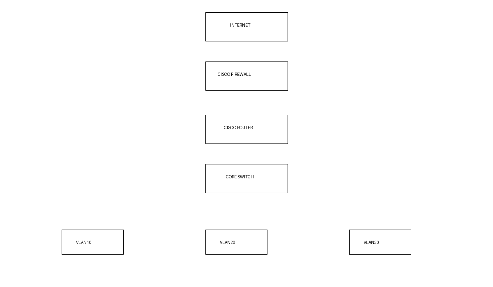

# Network and Security Administration Lab

Lab configurations and scripts for enterprise network work: Cisco switching and routing, host firewalling, VPN and monitoring. Addresses are examples (RFC 1918); no real credentials or client data.

| Folder | Content | Skills shown |
|---|---|---|
| `cisco/` | `sample-switch-config.txt` (VLANs, trunking, port-security, SSH-only management, NTP, logging), `router-intervlan-acl.txt` (inter-VLAN routing, ACLs) | Cisco, segmentation, secure access |
| `firewall/` | `ufw_rules.sh` default-deny policy with admin-network-only SSH | Firewall rules |
| `vpn/` | `server.conf`, `vpn-notes.md` | VPN, least-privilege routing |
| `monitoring/` | `network-check.sh` ping, loss, DNS and TCP checks with exit codes | Troubleshooting, monitoring |

Suggested verification (Cisco): `show vlan brief`, `show interfaces trunk`, `show port-security`, `show access-lists`.
